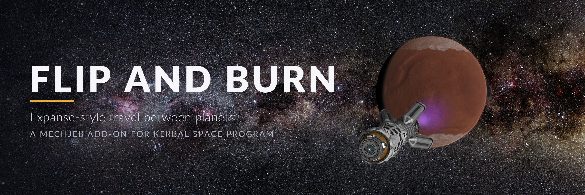

  

  <b>Expanse-style constant-thrust travel between planets, for Kerbal Space Program.</b> 
  KSP 1.12 · MechJeb 2.15+ · Public domain

---

In *The Expanse*, ships don't wait for transfer windows. They point at where they're going and burn the whole way:
speed up for half the trip, **flip** end over end at the midpoint, and **burn** the other half to slow down, arriving
gently. Flip and Burn lets your Kerbals travel like that. Pick a planet and an acceleration, and press Start. It works out
the trip, flies it, flips at the right moment, handles time warp, and parks you in a neat circular orbit at the other end.

  

## What it does

- **Plans the trip before you go:** how long it takes, when the flip happens, how fast you'll be going, and whether
  your ship has enough fuel.
- **Flies the whole thing for you:** steering, throttle and time warp, from your parking orbit at home to a circular
  orbit at the destination.
- **Two ways to fly:** burn the whole way (fastest), or burn, coast, then burn (much cheaper on fuel). If your ship
  can't afford the fast way, it suggests the cheaper one.
- **Two flip styles:** cut the engine, turn, relight; or keep the engine firing and swing around under thrust.
- **Looks after your ship:** steps down if your engines overheat, keeps 10% of your fuel in reserve on coast trips, and
  puts you in a safe orbit if something goes wrong on arrival.
- **Fits into your game:** it lives in MechJeb's menu, carries on after saving and loading, and leaves your MechJeb
  settings and warp setup exactly as it found them.

## Requirements

- **Kerbal Space Program 1.12** (1.12.5 is what it's tested on)
- **[MechJeb2](https://github.com/MuMech/MechJeb2/releases) 2.15 or later** (it adds itself to every command pod and probe core)
- **[Module Manager](https://github.com/sarbian/ModuleManager/releases)**, which MechJeb needs

A very powerful engine helps a lot. Burning the whole way between planets takes far more fuel than ordinary rockets
carry, so the fusion drives from [KSP Interstellar Extended](https://github.com/sswelm/KSP-Interstellar-Extended) are
what make trips like these practical. Stock engines work too, mostly on coast trips. See [Engines](docs/engines.md).

## Quick start

1. Download `FlipAndBurn-1.0.0.zip` from the [releases page](https://github.com/kbennett2000/flip-and-burn/releases), and
   copy the `FlipAndBurn` folder from inside it into your KSP `GameData` folder ([step by step](docs/installing.md)).
2. In orbit around a planet, open MechJeb's menu and click **Flip and Burn**.
3. Pick a planet, check the plan, and press **Start**.

The [first trip walkthrough](docs/first-trip.md) goes through it step by step, from Kerbin orbit to parked at Duna.

## The guide

| Page | What's in it |
|---|---|
| [Installing](docs/installing.md) | What to download, where the files go, and how to check it worked |
| [Your first trip](docs/first-trip.md) | Step by step, from opening the window to parked at Duna |
| [The windows explained](docs/windows.md) | Every row and button in the planner and the trip window |
| [Ways to fly](docs/ways-to-fly.md) | Full burn or coast, the two flip styles, and choosing an acceleration |
| [Saving, pausing and switching ships](docs/saving-and-pausing.md) | What happens to a trip when you leave it |
| [Safety](docs/safety.md) | What it refuses and why, the arrival safety net, the fuel reserve, boil-off |
| [Engines](docs/engines.md) | Which engines work, and what to expect from them |
| [Troubleshooting and FAQ](docs/troubleshooting.md) | Problems you might hit, and what to do |
| [Credits and license](docs/credits.md) | Who made what, and the (very short) license |

## License

Flip and Burn is in the public domain under the [Unlicense](LICENSE): anyone can use it, change it, or share it, for
anything, without asking.

For people working on the mod itself: [Developing Flip and Burn](docs/DEVELOPING.md).
