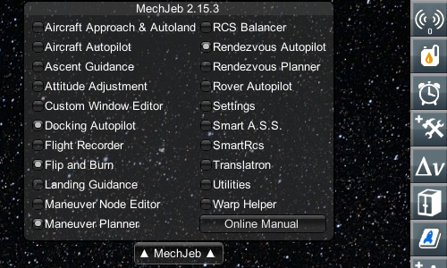
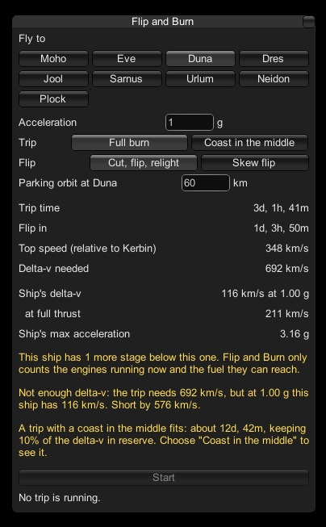
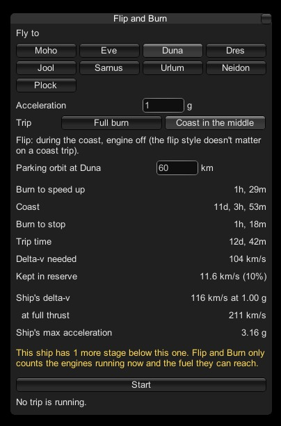
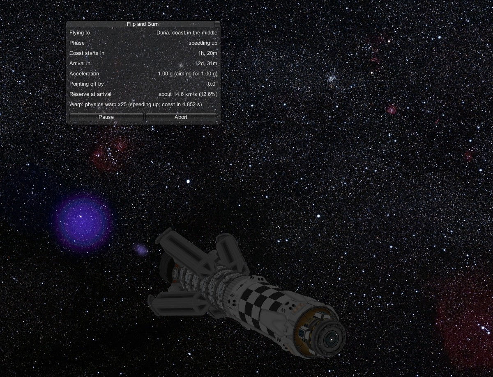
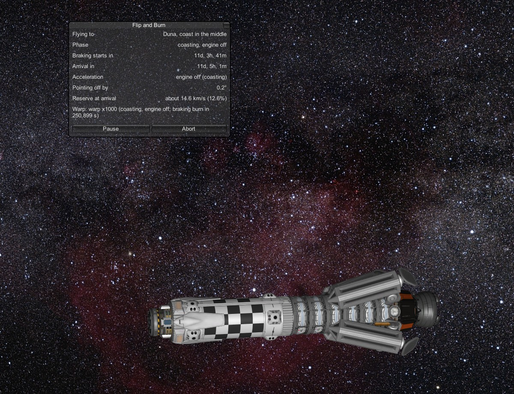
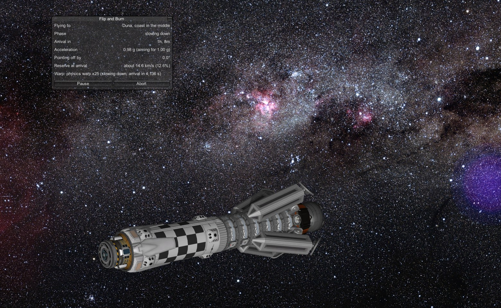
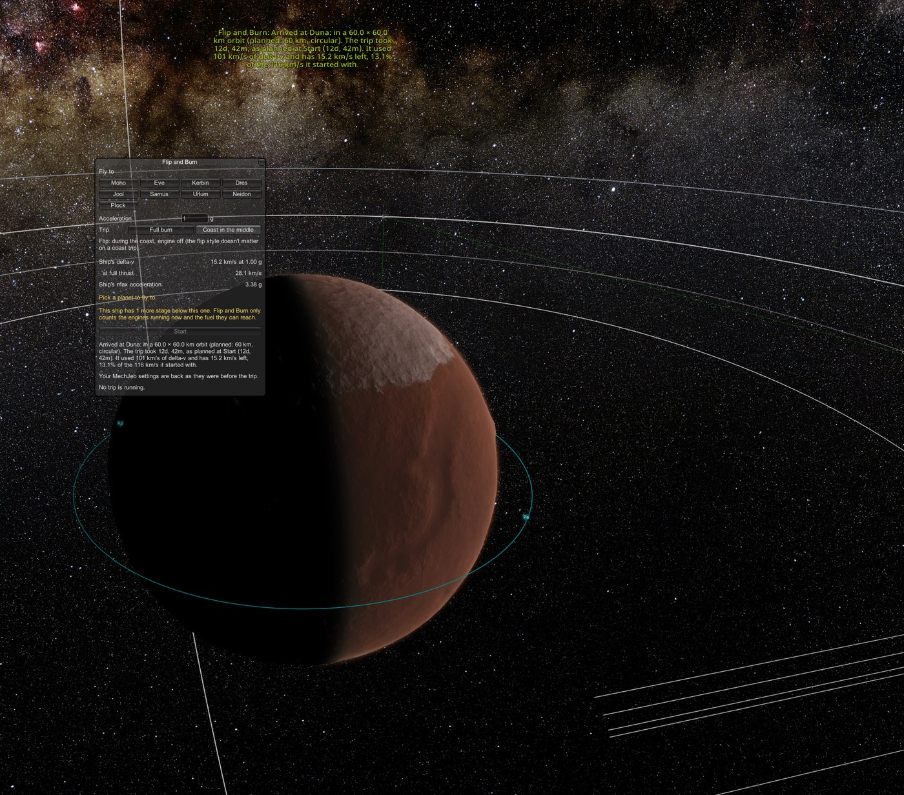

# Your first trip: Kerbin to Duna

[← Back to the README](../README.md)

This walkthrough flies a real trip, step by step, with a picture at each step: from a parking orbit around Kerbin to a
circular orbit around Duna. The ship in the pictures is the Bebop Refueller, a KSP Interstellar fusion ship. Your
numbers will differ with your ship, but every step is the same.

> **About the times:** KSP counts days as Kerbin days of 6 hours (unless you switched your game to Earth time). So
> "12d, 42m" means 12 Kerbin days and 42 minutes.

## Before you start

- **You need a ship with a lot of delta-v** (its fuel budget, as a speed). The Bebop has 116 km/s; a stock rocket has a
  few km/s and can't reach Duna this way, so Start would stay greyed out. See [Engines](engines.md) for what works.
- [Install Flip and Burn](installing.md) and its requirements.
- Put your ship in a **stable orbit around Kerbin**: anywhere above the atmosphere, roughly circular is best.
- Make sure **the engine you want to use is staged or activated.** Flip and Burn reads the engines that are running.
- Leave the throttle at zero. Flip and Burn takes over the throttle when you press Start.

## 1. Open the window

Click the **MechJeb** tab to open MechJeb's menu (the tab is on the right edge of the screen unless you've moved
it), then click **Flip and Burn**.

  

## 2. Pick Duna, and look at a full burn

In **Fly to**, click **Duna**. Leave the acceleration at **1 g** and the trip at **Full burn**.

  

The planner works the trip out straight away: about 3 Kerbin days, flipping after 1 day and 4 hours, at up to 348 km/s. That
would need **692 km/s** of delta-v (your ship's fuel budget, as a speed). The Bebop has 116 km/s, so the planner says
it's short and suggests a **coast trip** that fits: about 12 days.

Start is greyed out, because this trip can't be flown.

## 3. Switch to a coast trip

Click **Coast in the middle**.

  

Now the plan fits:

| | |
|---|---|
| **Burn to speed up** | 1 hour 29 minutes |
| **Coast** | 11 days, 3 hours, 53 minutes, engine off |
| **Burn to stop** | 1 hour 18 minutes |
| **Trip time** | 12 days, 42 minutes |
| **Delta-v needed** | 104 km/s of the 116 km/s the ship has |
| **Kept in reserve** | 11.6 km/s (10%), left over at Duna |

The **parking orbit** box says 60 km, just above Duna's atmosphere. That's where the trip ends. You can change it.

**Start** is lit. Press it.

## 4. Speeding up

Flip and Burn takes the ship. It turns toward Duna (the engine stays off until it's pointing within 5°), then burns.
Once the burn is steady, time warp kicks in.

  

The window now shows the trip as it flies: the phase, the time until the coast starts and until arrival, the
acceleration, how far off the pointing is, and the fuel expected to be left at Duna. The **Warp** line says what time
warp is doing and why. [The windows explained](windows.md#the-trip-window) goes through every line.

**Reserve at arrival** is what the ship will most likely have left at Duna. It's usually a little more than the 10% the
plan keeps, because the plan sets aside extra for steering and course corrections, and a trip rarely needs all of it.

Now just watch. If you need to save or do something else along the way, press **Pause**: see
[Saving, pausing and switching ships](saving-and-pausing.md).

## 5. The coast

After about an hour and a half, the engine shuts off and the ship coasts. It turns around during the coast, ready to
brake, and time warp runs fast: most of the 11 days goes by in a few minutes.

  

Now and then it may fire briefly for a **course correction**. That's normal.

## 6. Slowing down

As Duna gets close, time warp drops back, the engine relights facing the other way, and the ship brakes at about 1 g.

  

## 7. Arrived

Time warp stops in good time, the last burn rounds the orbit out, and the ship is parked. The window and an on-screen
message say how it went:

  

> Arrived at Duna: in a 60.0 × 60.0 km orbit (planned: 60 km, circular). The trip took 12d, 42m, as planned at Start
> (12d, 42m). It used 101 km/s of delta-v and has 15.2 km/s left, 13.1% of the 116 km/s it started with.

The engine is off, and MechJeb and time warp are back exactly as you had them. The ship is yours again.

## What next?

- Try a **full burn** on a ship with the fuel for it, and pick a [flip style](ways-to-fly.md#flip-styles).
- Read what Flip and Burn [does to keep your ship safe](safety.md).
- Something didn't go as expected? See [Troubleshooting](troubleshooting.md).

[← Back to the README](../README.md)
