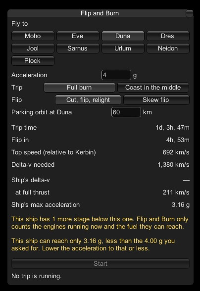
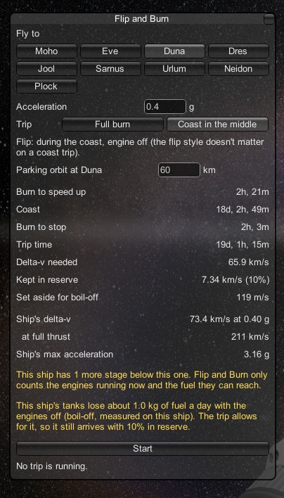

# Safety

[← Back to the README](../README.md)

Flip and Burn moves ships very fast, and it tries hard never to lose one. This page covers what it refuses to start,
what it watches during a trip, and what it does when something goes wrong.

## What it won't start, and why

The **Start** button only lights up when the trip can really be flown. When it can't, a yellow note in the planner says
why, in plain words, and usually what to change.

  

| The planner says | What to do |
|---|---|
| You're landed, in the atmosphere, or not in a stable orbit yet | Get into a stable orbit first. Trips start from orbit. |
| You're orbiting a moon | Flip and Burn flies between planets. Get into orbit around the planet, or out into orbit around the Sun. |
| No engine is active | Stage or activate your main engine, so Flip and Burn can read its thrust. |
| This ship can reach only *X* g | Lower the acceleration to what the ship can do. |
| Not enough delta-v | The ship doesn't have the fuel for a full burn. Try **Coast in the middle**; the planner suggests it with its trip time. |
| The destination's gravity is too strong at this acceleration | Choose at least the acceleration it names, or a higher parking orbit. |
| A coast trip can't go around the Sun yet | The Sun is between you and the target. Choose **Full burn**, or wait a while. |

**When the Sun is in the way** of a full burn, the trip doesn't fly through it: the planner routes it around the Sun in
two legs, and says so. The numbers it shows include the detour.

## During the trip

- **The engine only fires when the ship points the right way.** If the ship is more than 5° away from its burn
  direction (at Start, after a flip, after a resume), the throttle is held at zero until it lines up. The skew flip is
  the one exception, since firing through the turn is the whole idea.
- **Overheating is handled, not ignored.** Time warp slows as parts warm up. If a part reaches 90% of its temperature
  limit, the trip drops to a lower acceleration and re-plans. See [Ways to fly](ways-to-fly.md#what-overheating-does).
- **It stops and tells you** if it can't carry on: out of fuel, an engine lost, the ship can't turn fast enough to flip,
  or it has drifted too far off course to reach the target. The engine is cut and the window says what happened.
- **Abort** is always there. It cuts the engine, stops time warp, and hands the ship back to you with your settings as
  they were.

## The arrival safety net

The most dangerous moment is arriving: the ship comes in fast and has to stop above the atmosphere. Flip and Burn
watches that the whole way down. If it finds the ship:

- **falling too fast** to stop above the atmosphere at the thrust it can keep up, or
- **about to fly straight past** the planet,

it doesn't carry on with the plan and hope. It turns the ship and burns into the **safest orbit it can reach** around
the planet, then stops and tells you, with the orbit it got:

> Flip and Burn couldn't finish in the planned 60 km parking orbit: … It put the ship in a safe orbit around Duna
> instead, … Fly the last step yourself, or plan a new trip from here.

On a normal trip the safety net stays out of the way. In testing it stayed quiet on every normal arrival: 29 simulated
trips to Duna, Eve, Dres and Jool at accelerations from 0.25 g to 3 g, and every trip flown in the game.

## The 10% fuel reserve

A **coast trip** always keeps 10% of your ship's delta-v unused. You arrive with some fuel left for whatever you came to
do: landing, moving to a different orbit, or coming home. The planner shows the amount as **Kept in reserve**.

On top of that, the plan sets aside extra for steering and course corrections. Most trips don't need all of it, so
they usually arrive with a bit more than 10%. As the trip flies, the trip window shows what the ship will most likely
have left at arrival, worked out from the burning still to do. In testing it matched the arrival to within a point.

If that figure heads below 10% for any reason, the window says so in plain words, with the reason.

A **full burn** has no reserve built in: it either has the fuel for the trip or the planner won't start it.

## Boil-off

Some fuel tanks lose propellant over time when they aren't kept cold. KSP Interstellar's cryogenic tanks, for example,
boil off liquid deuterium once the ship runs out of power for their coolers: electric charge, and the reactor's power
store behind it. In a day-long test, once both had run out, the Bebop Refueller lost about 0.5 kg of deuterium an hour:
about 3 kg per 6-hour Kerbin day, or 12 kg per Earth day. On a coast trip of several weeks, that adds up.

Flip and Burn **measures** this instead of guessing. Whenever the planner window is open or a trip is flying, it notes
how much fuel disappears while no engine is firing, and remembers the rate for that ship. If the loss would make a real
difference, the coast plan allows for it, so you still arrive with your 10%, and the planner tells you. The picture is
from a shorter, 2½-hour measurement that started with cold tanks, so it came out lower: about 1 kg a Kerbin day. The
longer a ship is watched, the closer the figure gets.

  

If your tanks don't lose anything (and on most ships they don't, as long as the power stays on), you'll never see this
line. If the loss is so large that no coast trip can arrive with 10% left, the planner says so before you start.

Next: [engines →](engines.md)
