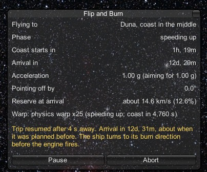

# Saving, pausing and switching ships

[← Back to the README](../README.md)

A trip to Duna takes days of game time, and you'll want to do other things along the way: save, quit for the night,
fly another ship, check the Tracking Station. Flip and Burn is built for that. **A trip never stops just because you
left it.** It pauses, and picks up again when you come back.

## The one KSP rule to know

KSP won't let you save, switch ships or leave the flight scene while a ship is accelerating at more than 0.1 g. The
buttons simply don't work. During a full burn the engine fires almost the whole way, so you'd be stuck.

That's what the **Pause** button is for.

## Pause and Resume

  

- **Pause** cuts the engine and keeps the trip. The ship coasts on its current path. Now KSP lets you save, switch
  ships or leave.
- **Resume** carries on from where the ship is now. It turns the ship to its burn direction before the engine fires.
- While paused, the window shows where the trip is going and when it was due to arrive.

## Leaving the ship

Whichever way you leave, the trip pauses (it doesn't stop):

- going to the Space Center, the Tracking Station or the main menu;
- switching to another ship;
- quickloading, or loading another save;
- quitting the game.

A short message says the trip is paused and that it will carry on when you come back to this ship.

## Coming back

When you return to the ship (by switching back, or by loading a save made during the trip), the trip **carries on by
itself**:

1. It waits a few seconds for the game to settle, with the engine held at zero.
2. It works out a fresh plan from where the ship is now, and on a coast trip it aims for the same arrival time as
   before.
3. It turns the ship to its burn direction, then fires.

  

A message tells you how long you were away and when it will now arrive. To arrive when it was going to, a coast trip may
use a little of the extra it keeps for steering, so the **Reserve at arrival** line may drop a little. If the reserve would
ever end up below 10%, the window says so and why. Days away means the ship coasted all that time, and the new plan
allows for it.

**If the trip can't be finished any more,** for example because the ship coasted too far off course, nothing fires.
The window says why and suggests planning a new trip from where you are.

## Things worth knowing

- **Each ship carries its own trip.** You can have trips going on several ships, but only the ship you're flying
  actually flies. The others wait, paused, until you come back to them.
- **A trip only flies on the ship you're on.** Flip and Burn doesn't fly ships in the background.
- **Abort ends a trip for good.** Nothing comes back if you load a later save. (Loading a save made *before* you
  pressed Abort brings the trip back, as you'd expect.)
- **Your settings are put back every time.** When a trip pauses, stops or arrives, MechJeb's settings and your time warp
  settings are exactly as they were before you pressed Start.
- **Removing Flip and Burn is safe,** even mid-trip. A save made during a trip still loads without the mod: the ship is
  all there, it just isn't on a trip any more.

Next: [safety →](safety.md)
