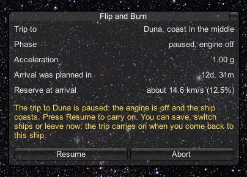
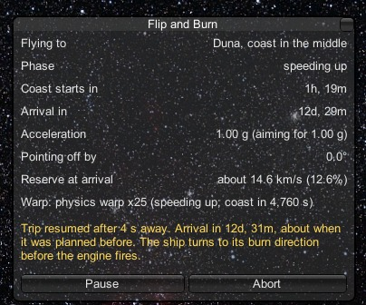

# Saving, pausing and switching ships

[← Back to the README](../README.md)

A trip to Duna takes days of game time, and you'll want to do other things along the way: save, quit for the night,
fly another ship, check the Tracking Station. Flip and Burn is built for that. **A trip never stops just because you
left it.** It flies on without you, and you get a message when it arrives.

## The one KSP rule to know

KSP won't let you save, switch ships or leave the flight scene while a ship is accelerating at more than 0.1 g. The
buttons simply don't work. During a full burn the engine fires almost the whole way, so you'd be stuck.

That's what the **Leave it flying** button is for.

## Leave it flying, Pause and Resume

While a trip is flying, the window has three buttons:

- **Leave it flying** turns the engine off for up to a minute, so KSP lets you go. Switch to another ship, or go to the
  Space Center or the Tracking Station, and the trip [flies on without you](#fleet-flights-trips-that-fly-without-you).
  If you stay, it carries on here when the minute is up, or straight away if you press **Stay and fly**.
- **Pause** cuts the engine and keeps the trip, and the trip waits. The ship coasts on its current path. Now KSP lets you
  save, switch ships or leave, but a paused trip doesn't fly on while you're away: it waits for you to come back.
- **Abort** ends the trip for good.

  

- **Resume** carries on a paused trip from where the ship is now. It turns the ship to its burn direction before the
  engine fires.
- While paused, the window shows where the trip is going and when it was due to arrive.

## Leaving the ship

Whichever way you leave, the trip flies on (it doesn't pause):

- going to the Space Center or the Tracking Station;
- switching to another ship.

When the engine is off (waiting in orbit for the departure window, coasting, or turning round in a cut, flip and
relight), KSP lets you leave straight away. During a burn, press **Leave it flying** first.

A short message names the ship, where it's going and the acceleration it flies on at.

Quitting the game, going to the main menu or loading a save don't lose a trip either. Time doesn't pass while the game
is closed, so the trip carries on from the save when you play again: from wherever the save says the ship was.

## Fleet flights: trips that fly without you

A trip you leave is flown by Flip and Burn in the background, the same way it would be flown with you watching:

- **The same plan and steering.** It keeps clear of planets and moons, waits for a moon's departure window, and makes
  the same corrections on the way.
- **The same acceleration you left it at.** If the trip had stepped down because the engines were overheating, it keeps
  the lower figure. It never steps back up while you're away. (Heat isn't checked for a ship you aren't flying, so this
  is the figure the trip has proven it can hold.)
- **Fuel and electric charge are used** as the burns use them. Check the tanks when you come back: they will have gone
  down.
- **Any time warp works,** in flight on another ship, at the Space Center and in the Tracking Station. When a ship
  you left is about to arrive, or warp is faster than Flip and Burn can fly it, time warp steps down by itself, so the
  ship stays where it should be and its arrival comes on time.

**When it arrives,** time warp drops to normal and a message names the ship, where it arrived and its orbit. It is
the same parking orbit a watched trip ends in (within 5% of the height you chose).

**If it can't finish the trip,** it does what a watched trip would: near the target it puts the ship in a safe orbit, and
the message says what happened. If it runs out of fuel, the message says so and the ship coasts on its orbit.

**Several ships can be on trips at once.** Each one flies on its own and gets its own message.

## Coming back

When you return to a ship whose trip is flying without you (by switching to it, or flying it from the Tracking
Station), you take it over where it is:

1. It waits a few seconds for the game to settle, with the engine held at zero.
2. It works out a fresh plan from where the ship is now, and on a coast trip it aims for the same arrival time as
   before.
3. It turns the ship to its burn direction, then fires.

A "Welcome back" message tells you how long the trip flew without you and when it will arrive. You can leave again at
any time.

A paused trip works the same way: when you come back to it, it carries on by itself.

  

When a paused trip carries on, the message says how long you were away and when it will now arrive. To arrive when it
was going to, a coast trip may use a little of the extra it keeps for steering, so the **Reserve at arrival** line may
drop a little. If the reserve would ever end up below 10%, the window says so and why.

**If the trip can't be finished any more,** for example because a paused ship coasted too far off course, nothing
fires. The window says why and suggests planning a new trip from where you are.

## Things worth knowing

- **Each ship carries its own trip,** saved with the ship. Saving, loading and quitting keep it.
- **Abort ends a trip for good.** Nothing comes back if you load a later save. (Loading a save made *before* you
  pressed Abort brings the trip back, as you'd expect.)
- **Your settings are put back every time.** When you leave a trip, or it pauses, stops or arrives, MechJeb's settings
  and your time warp settings are exactly as they were before you pressed Start.
- **A ship parked right next to the one you're flying** (inside KSP's physics range, a few hundred metres) waits until
  you move away: KSP moves ships that close, not Flip and Burn.
- **Removing Flip and Burn is safe,** even mid-trip. A save made during a trip still loads without the mod: the ship is
  all there, it just isn't on a trip any more.

Next: [safety →](safety.md)
