# Cycle 15a evidence: fleet flights, the warp hold, and the reserve shown (1.2.0 candidate)

All in-game runs on the test copy of the saves (`saves/FlipAndBurn-Test`), the Bebop Refueller (Kerbstein fusion drive)
and the Bebop V2.4. After every launch `build.sh` put back MechJeb's, BetterTimeWarp's and KSP's settings and checked
them byte for byte against its backup (identical every time). The simulator figures are in ADR 0003 and ADR 0006.

## Fleet flights and the warp hold (run 16, `fleetmun`)

Two ships left flying on their own; the test helper then warps as high as the game allows (asking for up to 100,000x)
until each arrives. Gated by the hold counters: never more than 120 s of game time behind the clock, ended within 60 s
of the clock passing its arrival.

| Ship | Trip | Orbit | Furthest behind the clock | Ended after the clock passed it |
|---|---|---|---|---|
| Bebop Refueller | Kerbin to the Mun, flown wholly without the player after a save and load | 19.87 x 20.09 km | 0.4 s | 0.0 s |
| Bebop V2.4 | Duna to Dres, a 213-day coast, warp asked up to 100,000x | 19.90 x 20.07 km | 92.8 s | 0.0 s (12,616 s late before the hold work, run 9) |

  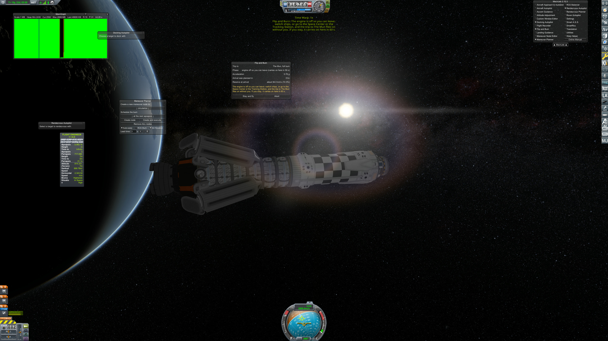
  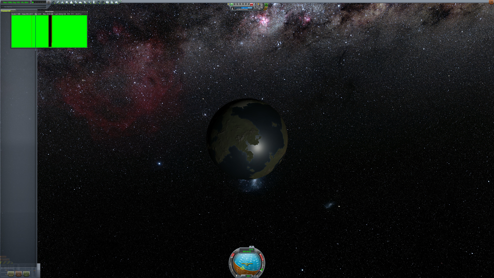

  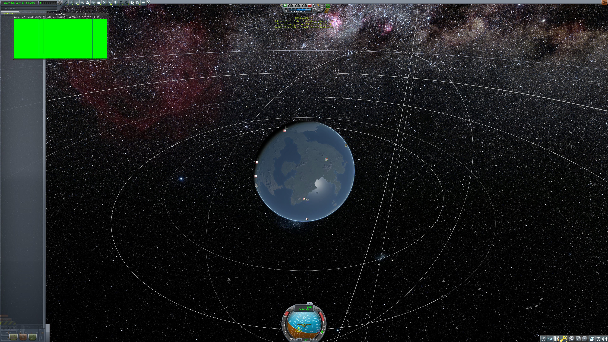
  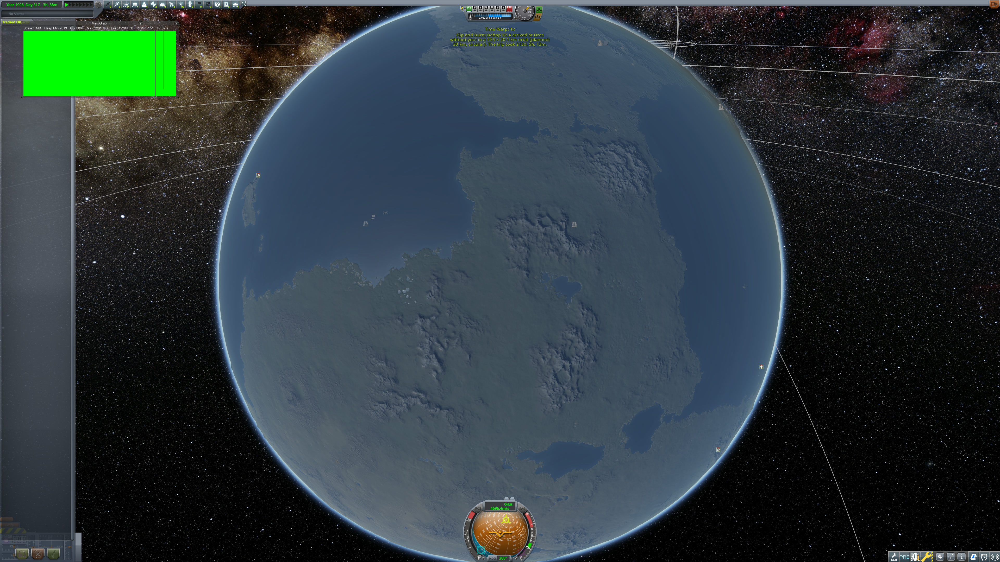

  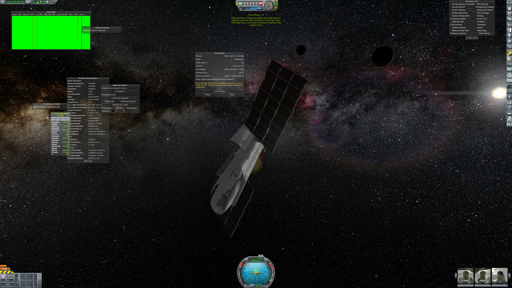
  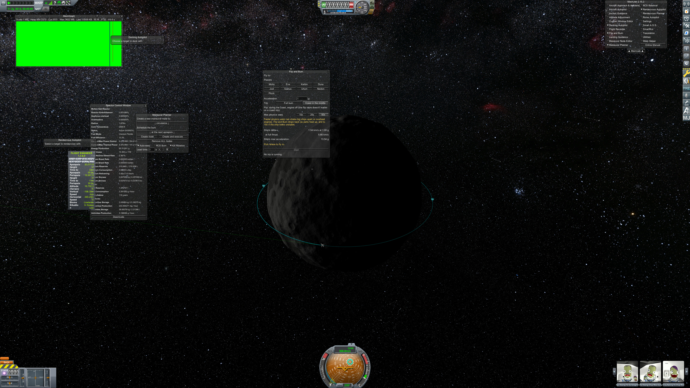

Earlier, run 9 (`fleetduna`): the Bebop's coast to Duna flown wholly in the background, 59.82 x 60.20 km.

  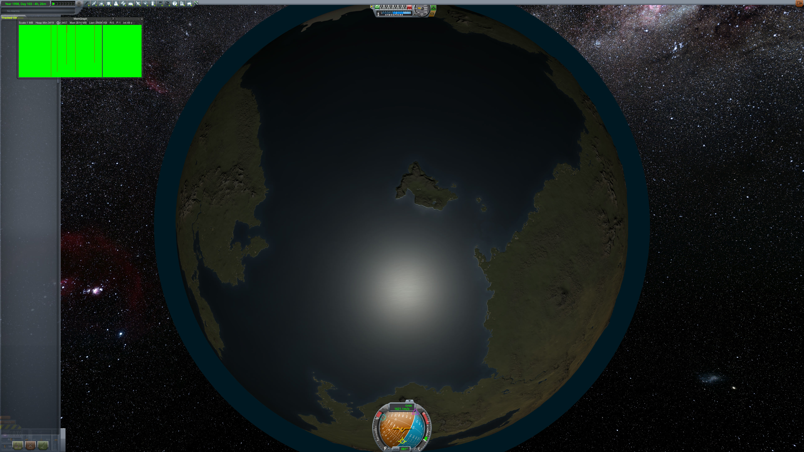
  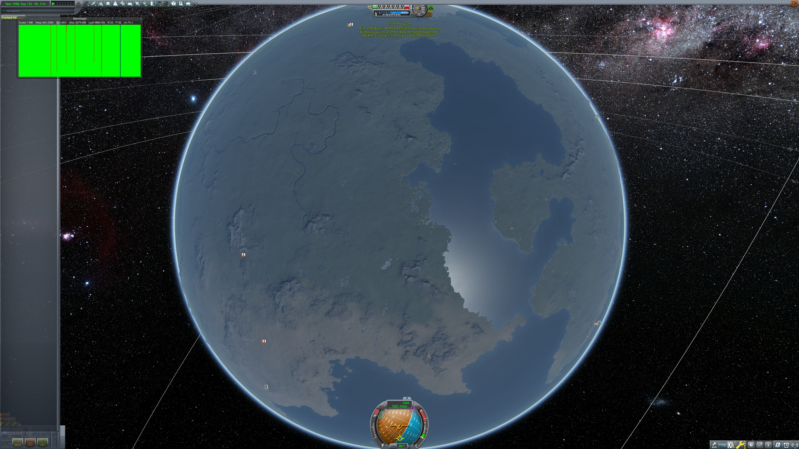

## The reserve shown, fuel counted (run 18, `tylocoast,tripR`): PASSED

Every figure the trip window showed, from Start to the arrival, within a point of what the ship arrived with.

| Trip | Orbit | Time against the plan | Arrived with | Shown at Start | Largest gap |
|---|---|---|---|---|---|
| Trip R: Kerbin to Duna, coast at 0.4 g, no cheats | 59.86 x 60.24 km | +22 s of 460,460 | 14.69 % | 13.82 % | 0.87 points |
| The Tylo coast: low Jool orbit to Tylo at 1 g | 29.70 x 30.32 km | +40 s of 8,296 | 13.30 % | 13.82 % | 0.70 points |

On the way here: run 9 (before the Kerbstein drive's part-throttle fuel was counted) showed 2.8 points too much after
the climb-out; run 14 (counted, but twice) read 3.6 points low at Start; run 17 left a course correction out of the
figure for a minute (1.8 points high). See ADR 0003.

  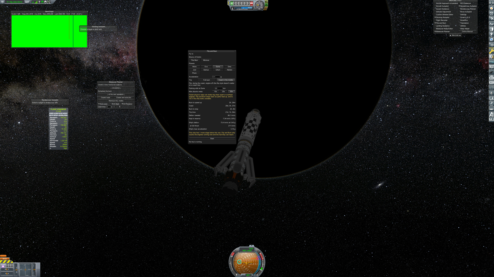
  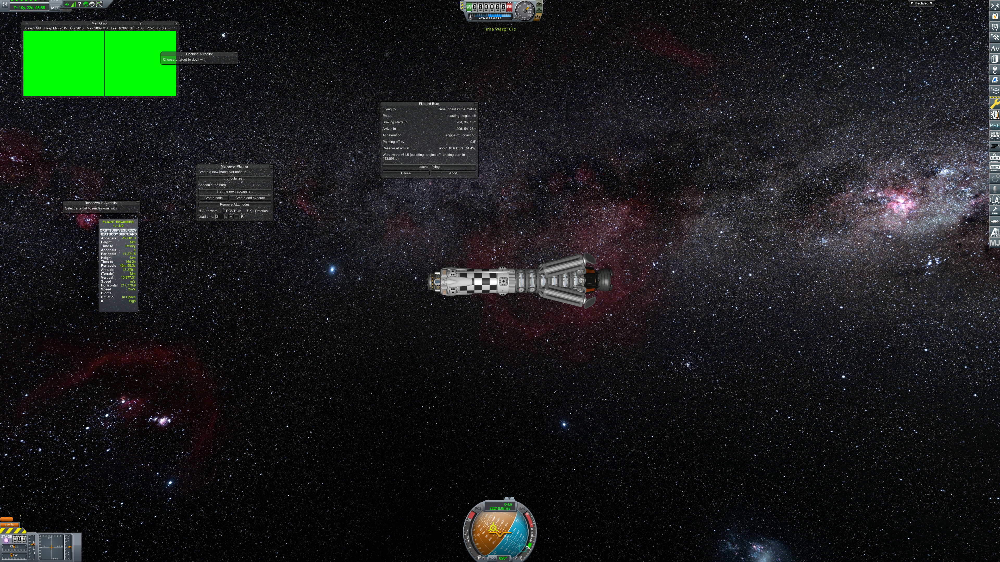

  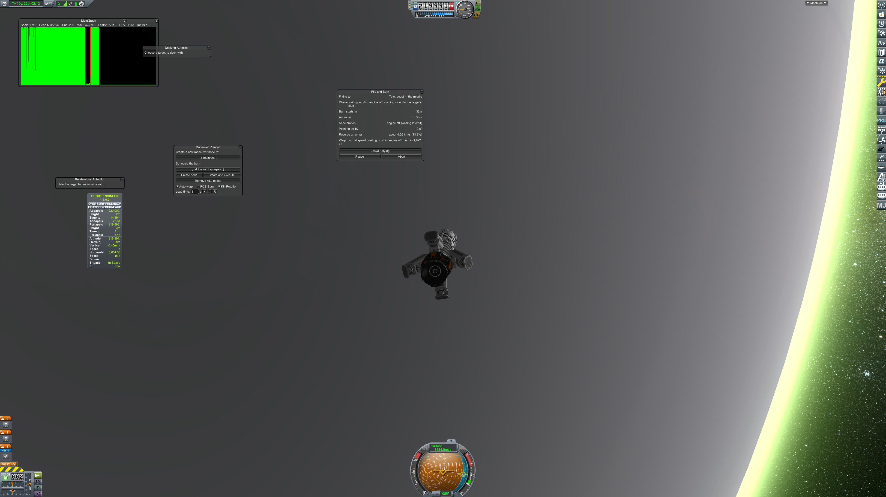
  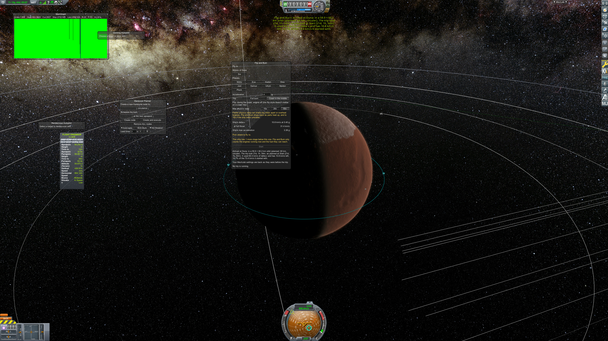

  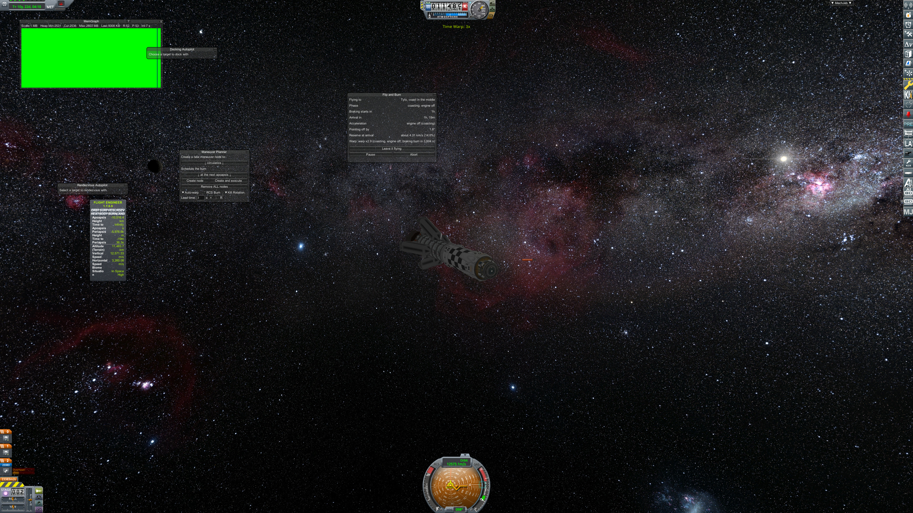
  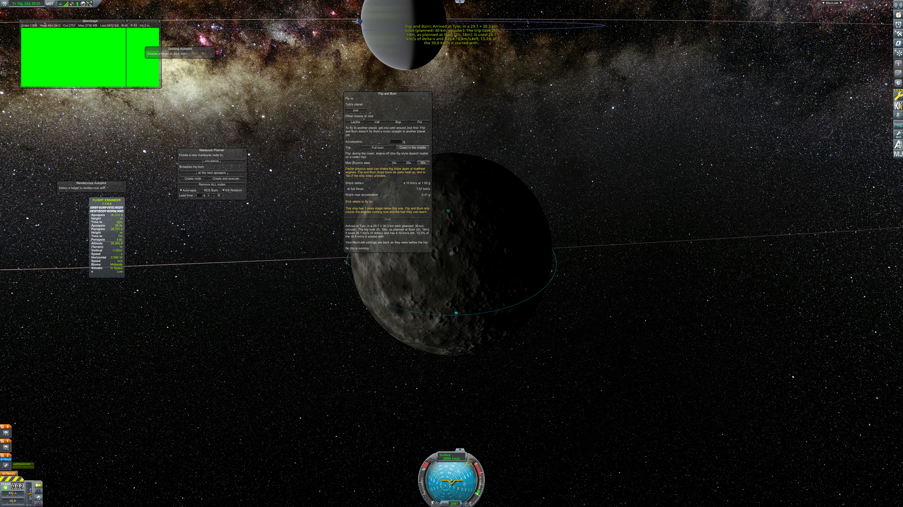

The harness log of run 18: [`c15-run18-test-run.log`](c15-run18-test-run.log).

## An interrupted run (2026-11-07)

Run 11 died when the computer went offline mid-trip; its backups had been in /tmp, which the restart cleared. Checked and
put right by hand (PR #14's handover has the details), and `build.sh` now keeps its backup in
`~/.local/state/flip-and-burn/test-backup` and refuses to start over one it never restored. Runs 12-18 were each
restored that way.
