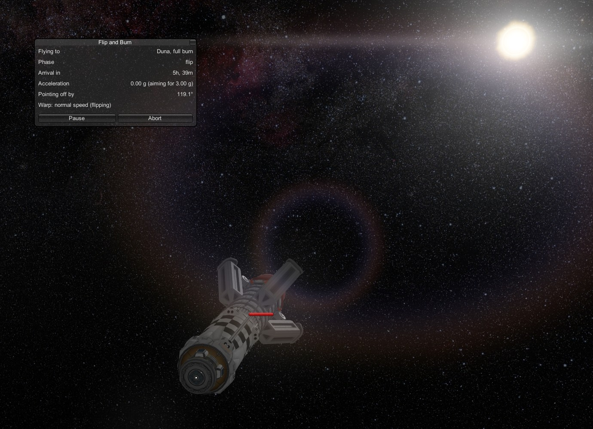
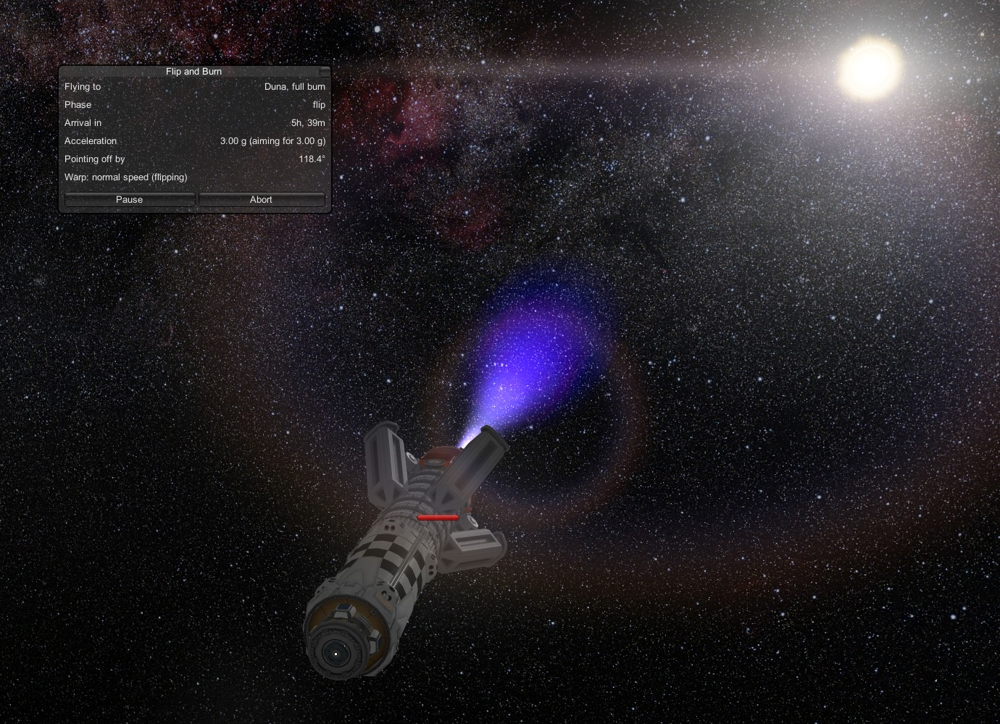

# Ways to fly

[← Back to the README](../README.md)

Flip and Burn gives you three choices before you press Start: **how hard to accelerate**, **whether to coast in the
middle**, and **how to flip**. This page explains each one and what it changes.

## A few words first

- **g** is how hard the ship pushes you back into your seat. 1 g feels like standing on Kerbin. At 1 g your speed goes
  up by about 10 m/s every second.
- **Delta-v** is the total change in speed your fuel can give you. Think of it as your ship's fuel budget, measured in
  speed instead of tons. MechJeb and KSP both show it.
- **Time warp** speeds up the game clock. Flip and Burn uses it for you during a trip, and slows back down in good time
  before anything happens.

## Choosing an acceleration

Type it in the **Acceleration** box of the planner, in g. The default is **1 g**.

- **Higher is faster, but hungrier.** Doubling the acceleration doesn't halve the trip: it cuts the time by about
  30% and needs about 40% more fuel.
- **1 g is the default, not a limit.** If your ship can push harder, you can type 2 or 3. The planner shows your
  ship's **max acceleration**, and won't let you start above it.
- **Lower is gentler on fuel and engines.** A Duna trip at 0.4 g takes a lot longer than at 1 g, but uses far less
  fuel and keeps the engine cooler.
- **The destination's gravity sets a floor.** To settle into orbit, the ship has to out-pull the planet's gravity at the
  parking orbit, so the planner asks for at least 10% more than that. It tells you the minimum if you're below it.

### What overheating does

Big drives get hot. If a part gets close to its temperature limit, Flip and Burn deals with it so you don't lose the ship:

- **Warm (60% of a part's limit):** time warp is held to 4×, so you can see what's happening.
- **Hot (75%):** time warp stops.
- **Too hot (90%):** it drops to a lower acceleration (four-fifths of the old one), re-plans the rest of the trip,
  tells you the new arrival time, and keeps flying. If even the lower acceleration can't finish the trip, it stops and
  says why.

This is normal with powerful drives. KSP Interstellar's fusion drives, for example, can push far harder on paper than
their radiators can keep up with for long. Flip and Burn finds the acceleration your ship can really sustain.

## Max physics warp

While the engine burns, Flip and Burn speeds the game up with **physics warp**. The **Max physics warp** buttons in
the planner set how far it goes: **10x** (the default), **25x** or **50x**. Your choice is remembered for next time.

- **10x** is steady on big ships, hot or cool. Start here.
- **25x and 50x** get you there in less real time, but KSP's physics gets rougher the faster it runs: big ships can
  wobble or shake apart, and hot engines heat up faster than they can cool. A yellow line under the buttons says so.

The protections work at every setting:

- **The heat rules above** still hold warp to 4× when a part is warm (60%) and stop it when a part is hot (75%).
- **If the ship looks unstable** at 25x or 50x, Flip and Burn drops back to **10x** for the rest of the trip and tells
  you why. It watches for parts heating up fast (on their way to 60% within about ten seconds), a part breaking off,
  and the ship wobbling when it should be holding steady.

## Full burn, or coast in the middle

The **Trip** buttons in the planner choose between these.

| | Full burn | Coast in the middle |
|---|---|---|
| **How it flies** | Burns the whole way: speed up, flip, slow down | Speeds up, coasts with the engine off, then slows down |
| **Speed** | The fastest trip at your acceleration | Slower: the coast takes most of the trip |
| **Fuel** | A lot. A Duna trip at 1 g needs about 690 km/s of delta-v | Whatever your ship can spare, keeping 10% in reserve |
| **Best for** | Ships with enormous fuel budgets | Almost every real ship |

**Full burn** is the classic *Expanse* trip. Burning the whole way takes far more fuel than ordinary ships carry: the
planner shows how much it needs, and what your ship has.

**Coast in the middle** is the practical choice. The planner finds the fastest trip your fuel allows, keeping 10% of
your delta-v in reserve for when you get there. It shows how long the speed-up burn, the coast and the slow-down burn
each take. If you choose a full burn your ship can't afford, the planner suggests a coast trip and says how long it
would take.

A real example, the Bebop Refueller (a KSP Interstellar ship) going from Kerbin orbit to Duna:

| Trip | Time | Delta-v used |
|---|---|---|
| Full burn at 1 g | about 3 days | about 690 km/s (far more than the ship has) |
| Coast in the middle at 0.4 g | 19 days, 5 hours | 64 km/s, arriving with 12.5% left |

(These are Kerbin days of 6 hours, the way KSP counts them unless you switched your game to Earth time.)

## Flip styles

Halfway through a full burn, the ship has to turn around so the engine points the way it's going and can slow it down.
There are two ways to do it. Choose with the **Flip** buttons in the planner.

<table>
<tr>
<td width="50%"></td>
<td width="50%"></td>
</tr>
<tr>
<td><b>Cut, flip, relight.</b> The engine shuts off, the ship turns end over end, and the engine relights pointing the
other way. Tidy and predictable.</td>
<td><b>Skew flip.</b> The engine keeps firing while the ship swings around, the way the ships in <i>The Expanse</i> do
it. It looks great, and the autopilot corrects the brief sideways push.</td>
</tr>
</table>

On a **coast trip** the flip happens during the coast, with the engine off, so the style doesn't matter and the planner
doesn't ask.

Either way, the engine never fires while the ship is pointing more than 5° away from where it should, except during a
skew flip, where firing through the turn is the point.

Next: [saving, pausing and switching ships →](saving-and-pausing.md)
