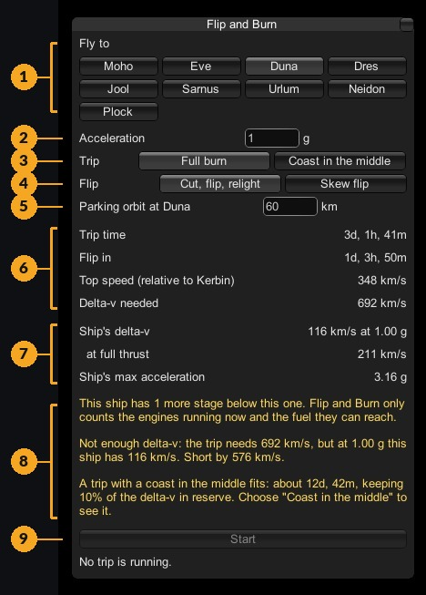
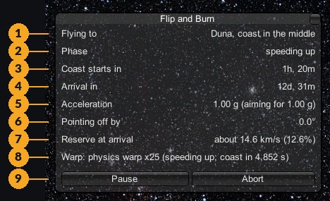
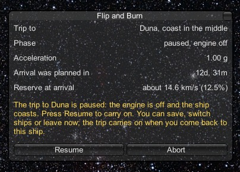
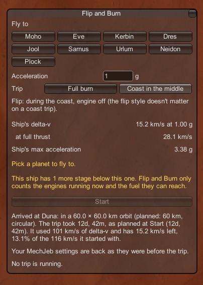

# The windows explained

[← Back to the README](../README.md)

Flip and Burn has one window, and it changes with what's going on:

- **The planner**, before a trip: choose where to go and how, and see what it takes.
- **The trip window**, while a trip is flying.
- **The paused window**, while a trip is paused.

Open it from MechJeb's menu (the **MechJeb** tab, on the right edge of the screen unless you've moved it) by clicking
**Flip and Burn**.

## The planner

  

1. **Fly to:** every planet in your game that orbits the Sun, except the one you're at. Click one to plan a trip to it.
2. **Acceleration:** how hard to push, in g. 1 g is the default. See [choosing an acceleration](ways-to-fly.md#choosing-an-acceleration).
3. **Trip:** **Full burn** (burn the whole way) or **Coast in the middle** (burn, coast, burn). See
   [full burn or coast](ways-to-fly.md#full-burn-or-coast-in-the-middle).
4. **Flip:** **Cut, flip, relight** or **Skew flip**. On a coast trip the flip happens during the coast, so a short
   note replaces the buttons. See [flip styles](ways-to-fly.md#flip-styles).
5. **Parking orbit:** the height of the circular orbit to finish in, in km. Each planet gets a sensible default, just
   above its atmosphere and mountains. Change it if you like.

   Below it (newer than this picture): **Max physics warp**, **10x**, **25x** or **50x**, how fast the game may run
   while the engine burns. 10x is the default and is remembered. 25x and 50x add a yellow warning line. See
   [max physics warp](ways-to-fly.md#max-physics-warp).
6. **The trip:** what this trip takes (the rows are listed below).
7. **Your ship:** what your ship can do (the rows are listed below).
8. **Notes, in yellow:** anything you should know, like a stage below this one not being counted, or why the trip can't
   be flown.
9. **Start:** lit up only when the trip can be flown. Press it and Flip and Burn takes the ship.

Below Start, the window shows how the last trip ended (arrived, aborted, or why it stopped), until you start another.

### The trip rows

| Row | Full burn | Coast in the middle | What it means |
|---|---|---|---|
| **Burn to speed up** | | ✓ | How long the first burn lasts |
| **Coast** | | ✓ | How long the ship coasts with the engine off |
| **Burn to stop** | | ✓ | How long the braking burn lasts |
| **Flip in** | ✓ | | How long until the halfway flip |
| **Top speed (relative to …)** | ✓ | | The fastest the ship goes, measured from the planet you're leaving |
| **Trip time** | ✓ | ✓ | From pressing Start to parked at the destination |
| **Delta-v needed** | ✓ | ✓ | The fuel budget the trip uses, as a speed |
| **Kept in reserve** | | ✓ | The 10% of your delta-v a coast trip never touches |
| **Set aside for boil-off** | | sometimes | Only if this ship's tanks were measured losing fuel. See [boil-off](safety.md#boil-off) |

### The ship rows

| Row | What it means |
|---|---|
| **Ship's delta-v** | Your ship's fuel budget, as a speed, at the acceleration you chose |
| **at full thrust** | The same at full throttle. It can differ, because some drives (like KSP Interstellar's) are more efficient at full throttle. |
| **Ship's max acceleration** | The hardest the engines can push the ship right now |
| **Electric charge made** | Only for engines that run on electricity: what the ship's generators and solar panels make each second (see [Engines that run on electricity](engines.md#engines-that-run-on-electricity)) |
| **engines need at …** | The electric charge the engines use each second at the acceleration you chose |
| **stored** | The electric charge in the batteries now, and how full they are |

For a ship with engines that run on electricity, the delta-v row ends in **(powered)** when the ship's own power keeps up
(the delta-v is then "unlimited") or **(batteries)** when the batteries limit it.

## The trip window

  

1. **Flying to:** the destination and the kind of trip.
2. **Phase:** what the ship is doing now (the phases are listed below).
3. **What's next:** the time to the next big moment: **Flip in**, **Coast starts in** or **Braking starts in**.
4. **Arrival in:** the time until the ship is parked at the destination.
5. **Acceleration:** what the ship is doing now, and what it's aiming for. They match during a burn. A lower "aiming
   for" than you chose means the trip stepped down to stop the engines overheating.
6. **Pointing off by:** how far the ship is from pointing where it should. The engine only fires when this is under 5°
   (except during a skew flip).
7. **Reserve at arrival:** the fuel the ship will most likely have left when it gets there, as a speed and a share of
   what it started with, worked out from the burning still to do. It's usually a little more than the 10% a coast plan
   keeps, because the plan sets aside extra for steering that a trip rarely needs. If it's heading below 10%, a yellow
   note says so and why. It's shown when fuel is being counted.
8. **Warp:** the time warp in use, and why. For example "physics warp x10 (speeding up; flip in 4,853 s)", or "normal
   speed (turning to the burn direction)".
9. **Pause** and **Abort.** Pause cuts the engine and keeps the trip; Abort ends it. See
   [saving, pausing and switching ships](saving-and-pausing.md).

For a ship with engines that run on electricity, two more rows show the power: **Electric charge stored** (how full the
batteries are; Flip and Burn never takes them below 10%) and **made / used** (the electric charge made and used each
second). If the batteries would run low before the burning is done, the trip lowers the acceleration, as it does for
overheating, and says so.

Messages in yellow appear above the buttons when something needs your attention: the trip resumed, the acceleration
stepped down, the reserve dropped below 10%, physics warp dropped back to 10x because the ship looked unstable, and so
on.

### The phases

| Phase | What's happening |
|---|---|
| **speeding up (climbing out of orbit)** | The first part of the burn, climbing away from the planet you're leaving |
| **speeding up** | Burning toward the destination |
| **flip** | Turning end over end to face the other way |
| **coasting, engine off** | Coast trips only: drifting at speed, with time warp doing the work |
| **coasting (course correction)** | A short burn to stay on course during the coast |
| **slowing down** | Burning against the direction of travel to arrive at the right speed |
| **final approach** | Arriving at the destination planet |
| **final approach (settling into orbit)** | The last burn, rounding the orbit out at the parking altitude |
| **arrived** | Parked. The window goes back to the planner and shows the arrival report. |

## The paused window

  

While a trip is paused, the window shows where it's going, the acceleration, when it was due to arrive, and the reserve.
**Resume** carries on from where the ship is; **Abort** ends the trip. If the trip paused because you left the ship,
there's no Resume button: it carries on by itself when you come back.

## The arrival report

When the ship is parked, the window and an on-screen message say how it went:

  

The orbit it ended in, how long the trip took against the plan, and how much delta-v it used and has left. The last line
confirms your MechJeb settings are back as they were before the trip. A ship with engines that run on electricity also
gets a line on its power: that its own power kept the engines going, and how full its batteries are.

Next: [ways to fly →](ways-to-fly.md)
